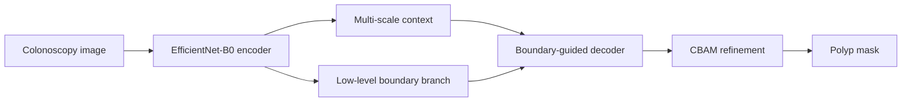

<div align="center">

# LiteTC-PolypNet-B0

### Lightweight Boundary-Aware Colorectal Polyp Segmentation

[](https://www.python.org/)
[](https://pytorch.org/)
[](https://datasets.simula.no/kvasir-seg/)

</div>

## Overview

LiteTC-PolypNet-B0 is a compact segmentation network for locating colorectal polyps in colonoscopy images. It combines EfficientNet-B0 features with multi-scale context, boundary guidance, attention-based refinement, and deep supervision.

## Architecture



## Dataset and training

- Dataset: 1,000 Kvasir-SEG image–mask pairs
- Split: 80% train, 10% validation, 10% test
- Split stratification: mask-area groups
- Input resolution: 352 × 352
- Loss: BCE + Dice + focal + boundary + auxiliary supervision

## Reported results

| Metric | Single scale | TTA + post-processing |
|---|---:|---:|
| Dice | **0.8983** | **0.9045** |
| IoU | **0.8154** | **0.8257** |
| Precision | 0.9096 | 0.9189 |
| Recall | 0.8873 | 0.8906 |
| Accuracy | 0.9700 | 0.9719 |

| Efficiency measure | Result |
|---|---:|
| Trainable parameters | **4.804M** |
| MACs | **1.844G** |
| Batch-1 latency | **18.40 ms/image** |
| Throughput | **54.35 FPS** |

## Repository contents

```text
litetc-polypnet-b0/
├── notebooks/litetc_polypnet_b0.ipynb
├── requirements.txt
└── README.md
```

The notebook output was cleared for a smaller, credential-safe public release. Run it in sequence to regenerate figures, checkpoints, and evaluation tables.

## Reproducibility boundaries

The current evidence covers one random split of Kvasir-SEG. Direct same-protocol baselines, cross-dataset evaluation, repeated seeds, and video-level temporal testing are still needed before making broader generalization claims.

## Responsible-use notice

This repository is for research and education. It is not a clinically validated polyp-detection system.

## Contact

**Protik Biswas** · [GitHub](https://github.com/pkhunter47) · [LinkedIn](https://www.linkedin.com/in/protik-biswas-83001827b/) · [Email](mailto:protikbiswas3099@gmail.com)
